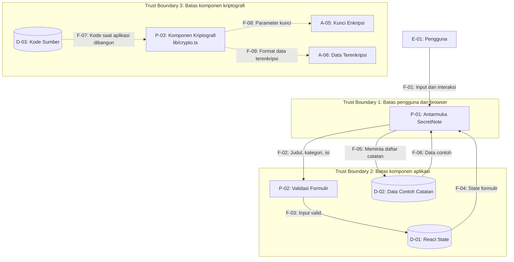
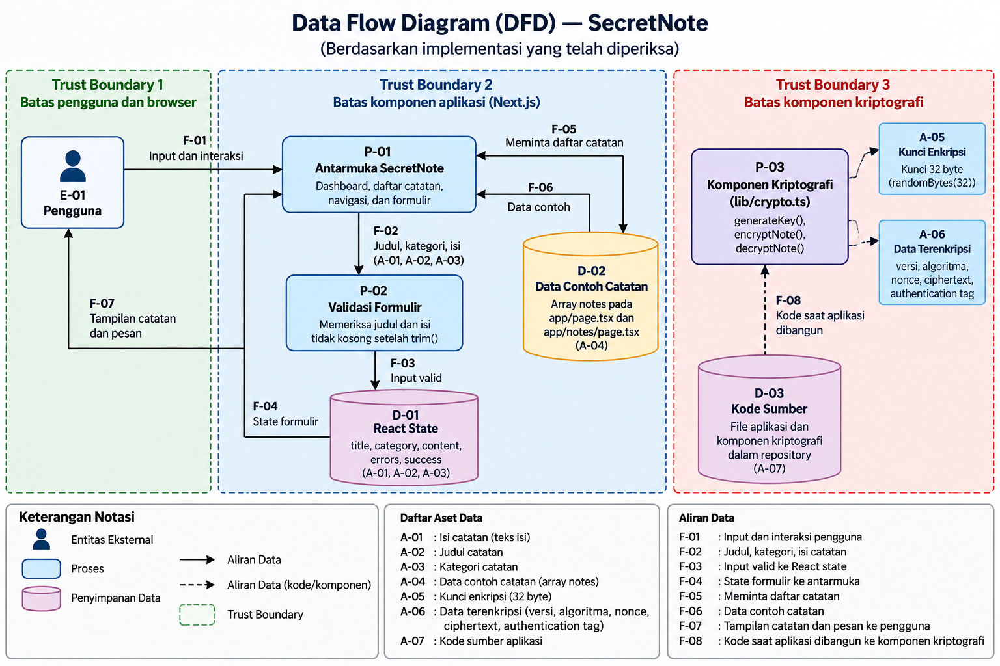

# Data Flow Diagram (DFD) — SecretNote

## 1. Tujuan

Dokumen ini menggambarkan aliran data pada aplikasi SecretNote berdasarkan implementasi yang telah diperiksa. Diagram membedakan fitur antarmuka yang sudah berjalan dari komponen kriptografi yang belum terintegrasi dengan formulir catatan.

## 2. Identifikasi Elemen

| ID | Jenis | Nama Elemen | Keterangan |
|---|---|---|---|
| E-01 | External Entity | Pengguna | Pengguna yang membuka halaman dan mengisi formulir catatan |
| P-01 | Process | Antarmuka SecretNote | Dashboard, daftar catatan, navigasi, dan formulir |
| P-02 | Process | Validasi Formulir | Memeriksa agar judul dan isi catatan tidak kosong setelah `trim()` |
| P-03 | Process | Komponen Kriptografi | Fungsi `generateKey()`, `encryptNote()`, dan `decryptNote()` pada `lib/crypto.ts` |
| D-01 | Data Store | React State | State sementara `title`, `category`, `content`, `errors`, dan `success` pada formulir |
| D-02 | Data Store | Data Contoh Catatan | Array `notes` yang ditulis langsung pada `app/page.tsx` dan `app/notes/page.tsx` |
| D-03 | Data Store | Kode Sumber | File aplikasi dan komponen kriptografi dalam repository |
| A-01 | Data Asset | Isi Catatan | Teks isi catatan yang dimasukkan pengguna |
| A-02 | Data Asset | Judul Catatan | Judul catatan |
| A-03 | Data Asset | Kategori Catatan | Kategori catatan |
| A-05 | Data Asset | Kunci Enkripsi | Kunci 32 byte yang diberikan ke komponen kriptografi |
| A-06 | Data Asset | Data Terenkripsi | Objek yang berisi versi, algoritma, nonce, ciphertext, dan authentication tag |

## 3. Diagram Aliran Data

## 4. Aset yang Dilindungi Kriptografi

| ID Aset | Nama | Status Perlindungan |
|---|---|---|
| A-01 | Isi catatan | Belum dienkripsi dalam alur formulir aplikasi |
| A-02 | Judul catatan | Belum dienkripsi dalam alur formulir aplikasi |
| A-03 | Kategori catatan | Belum dienkripsi dalam alur formulir aplikasi |
| A-05 | Kunci enkripsi | Dipakai sebagai parameter komponen kriptografi; penyimpanan dan pengelolaan kunci persisten belum diimplementasikan |
| A-06 | Data terenkripsi | Dapat dihasilkan oleh `encryptNote()` dan diproses oleh `decryptNote()`, tetapi belum terintegrasi dengan penyimpanan catatan aplikasi |

Pada diagram, komponen kriptografi diberi identitas tersendiri karena telah tersedia dalam kode, tetapi belum dipanggil oleh alur formulir yang diperiksa. Karena itu, tidak digambarkan aliran ciphertext dari formulir ke penyimpanan permanen.

## 5. Batasan Diagram

Diagram ini merupakan pemodelan awal berdasarkan `app/page.tsx`, `app/notes/page.tsx`, `app/notes/new/page.tsx`, `lib/crypto.ts`, dan `README.md`.

Tidak ada database atau penyimpanan catatan permanen yang digambarkan karena implementasi tersebut belum dibuktikan oleh kode yang diperiksa. Trust boundary pada diagram merupakan batas analisis untuk pemodelan keamanan, bukan klaim bahwa setiap kelompok kode telah berjalan dalam proses atau lingkungan terisolasi yang berbeda.

## Diagram DFD

